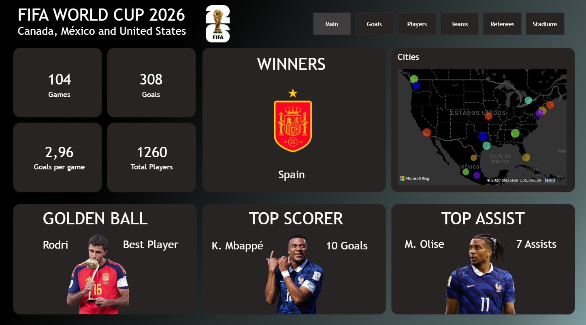
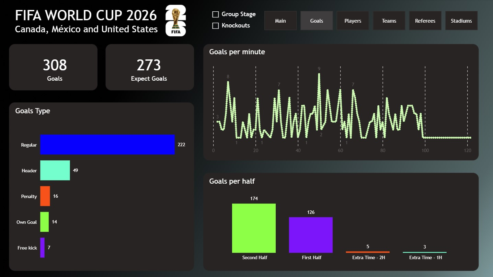
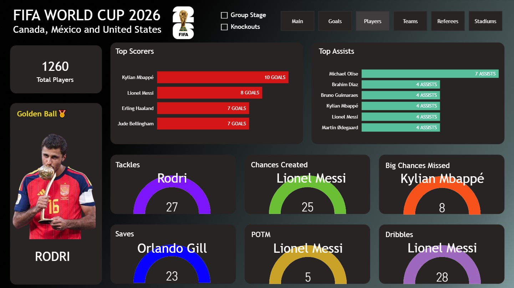
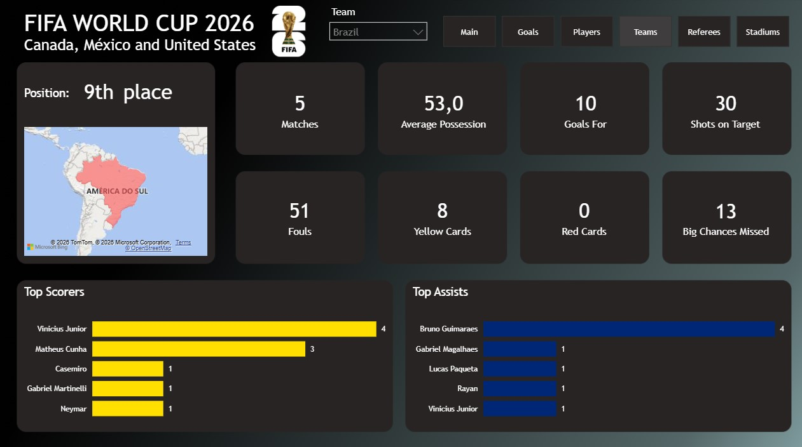
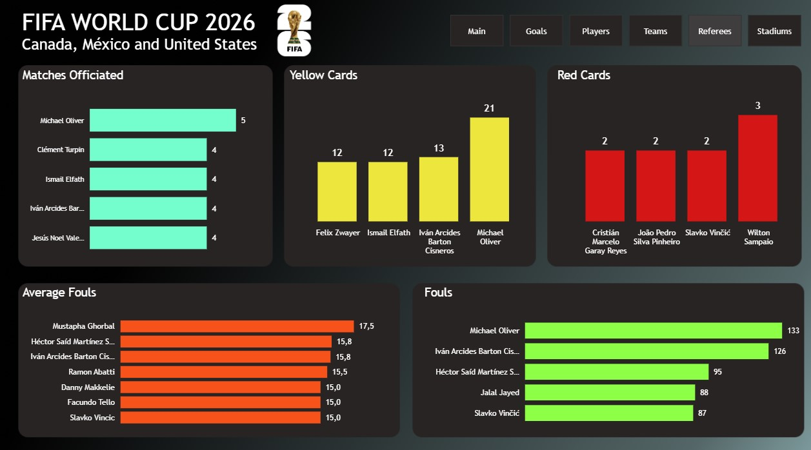
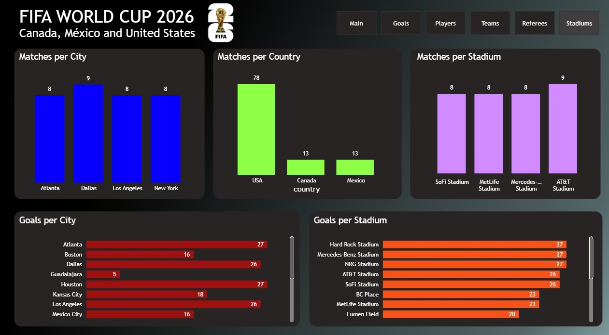
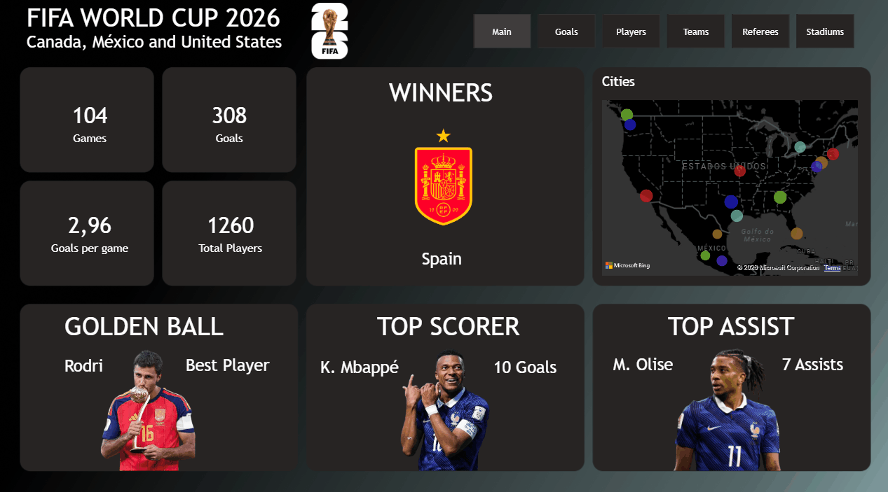

# World Cup 2026 Analysis

Projeto de análise e visualização de dados da Copa do Mundo FIFA 2026, desenvolvido no Power BI. O objetivo é explorar diferentes aspectos da competição, transformar os dados em indicadores relevantes e apresentar os resultados por meio de dashboards interativos.

O projeto reúne seis páginas de análise: visão geral, gols, jogadores, seleções, arbitragem e estádios. Além da construção dos dashboards, foram desenvolvidas medidas em DAX e uma identidade visual própria para cada página, com planos de fundo criados no Figma.

## Preparação e desenvolvimento

O desenvolvimento envolveu a preparação e padronização dos dados no Power Query, incluindo ajustes nos tipos de dados e nomenclatura das colunas. Também foram criadas medidas utilizando DAX para calcular indicadores e rankings da competição. Por fim, os planos de fundo das seis páginas foram desenvolvidos no Figma, criando uma identidade visual própria para o dashboard.

## Dashboard

O relatório foi organizado para permitir uma exploração da competição em diferentes perspectivas. Cada página apresenta indicadores e visualizações específicos, com filtros que facilitam a análise dos dados.

### 1. Visão geral

Apresenta um resumo da competição, com indicadores como total de partidas, gols, média de gols por jogo e número de atletas. Também destaca a seleção campeã, o vencedor da Golden Ball, o artilheiro e o líder em assistências, além de um mapa com as cidades-sede.

### 2. Gols

Explora a distribuição dos gols por minuto e por tempo de jogo, além de classificá-los por tipo, como gols de cabeça, pênaltis e gols contra. A página também apresenta o total de gols e os gols esperados (xG), com a possibilidade de filtrar os dados por fase da competição.

### 3. Jogadores

Reúne rankings e estatísticas individuais dos atletas. Permite acompanhar artilheiros, assistentes e líderes em categorias como desarmes, chances criadas, grandes chances perdidas, defesas, prêmios de melhor jogador da partida (POTM) e dribles. Os dados podem ser filtrados por fase da competição.

### 4. Seleções

Apresenta indicadores de desempenho das seleções, incluindo partidas, posse média de bola, gols, chutes a gol, faltas, cartões e grandes chances perdidas. Também permite consultar os artilheiros e assistentes de cada equipe.

Um dos recursos desenvolvidos foi a aplicação dinâmica das cores das seleções nos gráficos de artilheiros e assistentes, utilizando medidas DAX. Ao selecionar uma equipe, os indicadores e as visualizações são atualizados de acordo com a escolha.

### 5. Árbitros

Apresenta estatísticas da arbitragem, como partidas apitadas, cartões amarelos e vermelhos, faltas marcadas e média de faltas por partida. Esses indicadores permitem comparar a atuação dos árbitros ao longo da competição.

### 6. Estádios

Mostra a distribuição das partidas e dos gols por cidade, país e estádio. A página permite identificar quais localidades concentraram mais jogos e gols durante o torneio.

## Principais análises

A exploração dos dados permitiu identificar alguns resultados de destaque:

- **Gols:** foram registrados 308 gols, enquanto o xG apontava uma expectativa de 273, uma diferença de 35 gols acima do esperado.
- **Média de gols:** a média por partida se destacou na comparação histórica apresentada na análise.
- **Jogadores:** Lionel Messi registrou cinco prêmios de melhor jogador da partida (POTM), igualando sua marca na edição de 2022. Kylian Mbappé e Michael Olise lideraram, respectivamente, os rankings de artilharia e assistências.
- **Arbitragem:** Michael Oliver liderou em partidas apitadas e cartões amarelos, com 21 cartões em cinco jogos, média de 4,2 por partida.
- **Estádios:** os Estados Unidos concentraram 78 partidas, enquanto Canadá e México receberam 13 cada. Dallas foi a cidade com mais jogos, totalizando nove partidas.

Esses resultados são alguns dos pontos identificados durante a exploração; os dashboards permitem consultar outros indicadores e observar os dados sob diferentes perspectivas.

## Tecnologias e ferramentas

- **Power BI:** criação dos dashboards, indicadores e visualizações.
- **DAX:** desenvolvimento de medidas e cálculos.
- **Power Query:** preparação e transformação dos dados.
- **Figma:** criação dos planos de fundo e identidade visual.

## Demonstração

Veja abaixo uma demonstração do dashboard em funcionamento, navegando entre as páginas e utilizando os filtros interativos.

